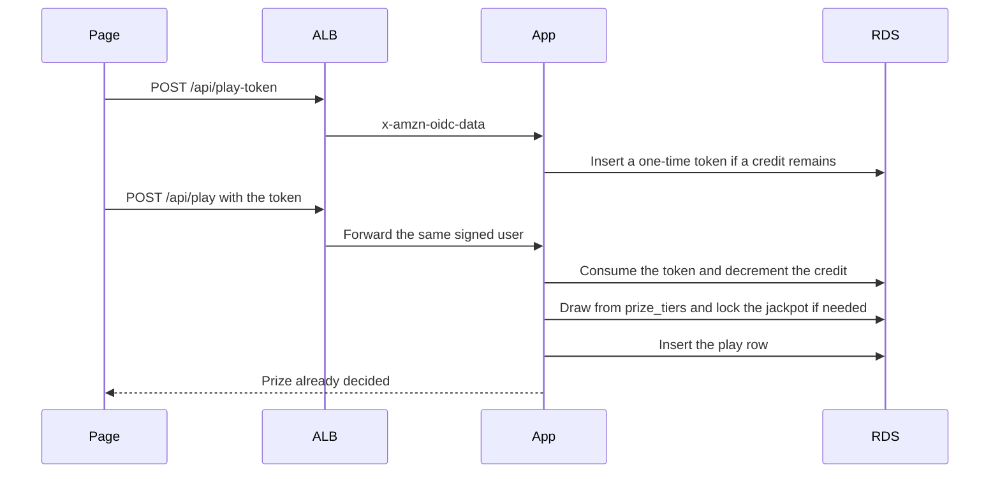
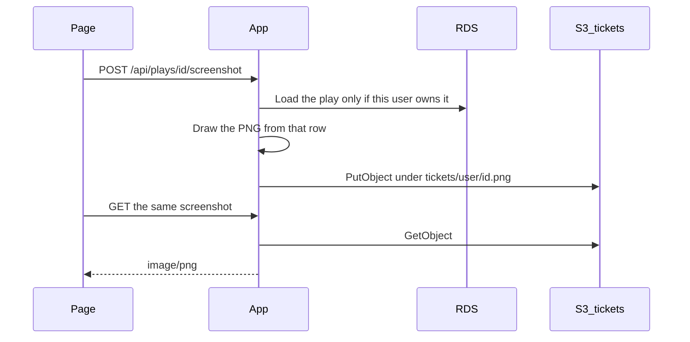
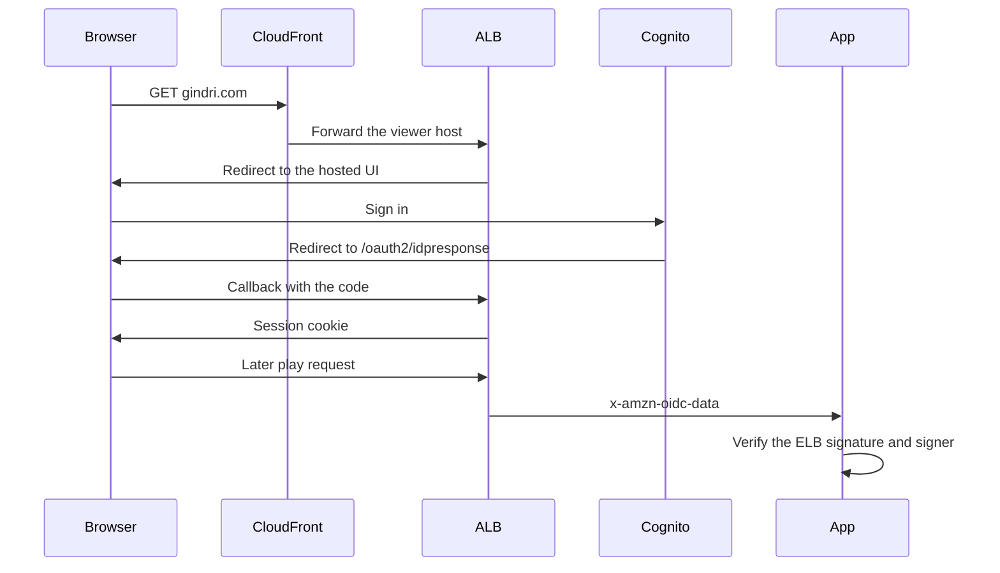
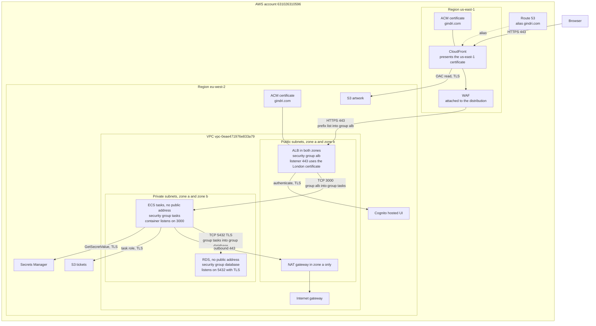

# Scratch card

A practice scratch card. The prize is decided on the server. The page only shows the foil. One player can win £1,000,000. A second claim on the same jackpot is stored as a loss.

This is a lab for building that game on AWS and explaining the security. It is not a real stake. The draw uses `crypto.randomInt`, which is fit for practice and is not a certified gambling generator.

Play it on this computer with npm. The same process runs on ECS Fargate when `NODE_ENV=production`.

## Run it locally

Node 20 or newer.

```bash
npm install
npm run dev
```

Open http://localhost:3000. Sign-in is skipped because `npm run dev` sets `NODE_ENV=development`. The player is `local-player` unless you set `DEV_AUTH_SUB`. Scores live in `.data/` through PGlite, so the two daily plays survive a restart. Leave `DATABASE_URL` unset unless you want the same SQL against PostgreSQL.

```bash
npm run check
```

That repeats the credit, replay, reset, and jackpot rules in `.data-check/`.

## How a play works

Each person gets two plays for the London day. The reset is not a clock job. It happens inside the credit update the next time that person plays after midnight.

Odds live in `prize_tiers`:

| Outcome | Chance | Prize |
| --- | --- | --- |
| Lose | 70% | £0 |
| Small win | 25% | £2 |
| Jackpot attempt | 5% | £1,000,000 if the jackpot row is still available |

The page asks for a one-time token, then sends that token with the play. The token lasts two minutes, belongs to one user, and is consumed in the same database transaction as the credit. A third play the same day updates no row. Sending the same token again rolls the transaction back.

The jackpot is one row. The transaction locks it with `SELECT … FOR UPDATE`. Only a row still marked available can be claimed.



The credit update in `src/play.js` is the two-plays-a-day rule:

```sql
UPDATE user_credits
SET credits_remaining = CASE
      WHEN last_reset_date < $2::date THEN 2
      ELSE credits_remaining
    END - 1,
    last_reset_date = CASE
      WHEN last_reset_date < $2::date THEN $2::date
      ELSE last_reset_date
    END
WHERE user_id = $1
  AND (last_reset_date < $2::date OR credits_remaining > 0)
RETURNING credits_remaining;
```

## Save a ticket

**Save screenshot** asks the server to draw a PNG from that player's row in `plays`. The browser never uploads the picture. On AWS the file is `tickets/{user}/{play}.png` in the ticket bucket. Locally, with `TICKET_BUCKET` unset, it is written under `.data/tickets/`. A play that belongs to someone else returns 404.



## Sign-in

On AWS the load balancer runs Cognito. The app never sees the client secret. After sign-in the load balancer sends `x-amzn-oidc-data`. The app checks the ELB signature, requires `exp`, and matches `signer` to `ALB_ARN` when that variable is set. `/health` is the only path that skips Cognito, because the health check cannot log in, and it does not touch the database.

The public name is `gindri.com`. The callback is `https://gindri.com/oauth2/idpresponse`.



CloudFront is in the design and in `infra/platform`. This AWS account is not verified for new CloudFront distributions yet, so that hop is not serving traffic. The load balancer, Cognito, and the origin-header rule are already on.

## High-level design

The order is **account → region → VPC → availability zone → subnet**. A VPC lives in one region. A subnet lives in one availability zone.

| Level | This lab |
| --- | --- |
| Account | `631026310596`. The bill and the IAM role `gindriliunas`. |
| Region | `eu-west-2` (London) for the app, the database, and the load balancer. |
| VPC | `vpc-0eae471976e833a79`. Address ranges `172.51.0.0/16` and `172.31.0.0/16`. The second range is unused. |
| Availability zone | `eu-west-2a` and `eu-west-2b`. |
| Subnet | `public-a` and `private-a` in zone a. `public-b` and `private-b` in zone b. |

CloudFront, its certificate, and the WAF sit in `us-east-1` because AWS requires that. One NAT gateway sits in one public subnet. A production design would put a NAT gateway in each zone.



| Certificate | Region | Presented by |
| --- | --- | --- |
| `gindri.com` | `us-east-1` | CloudFront, to the browser. Both certificates are issued. CloudFront cannot use the London certificate. |
| `gindri.com` | `eu-west-2` | The load balancer listener on 443. It matches the `Host` that `AllViewer` forwards. |

| Security group | Attached to | Inbound |
| --- | --- | --- |
| Load balancer | The load balancer in both public subnets | TCP 443 from the CloudFront origin-facing prefix list `com.amazonaws.global.cloudfront.origin-facing`. Not from `0.0.0.0/0`. |
| Tasks | The ECS tasks in the private subnets | TCP 3000 from the load balancer group only. |
| Database | RDS in the private subnets | TCP 5432 from the task group only. |

Outbound on these groups stays open. The inbound rules are the fence. Tasks reach ECR, Secrets Manager, CloudWatch, and S3 through the NAT gateway on 443.

| Part | Restriction |
| --- | --- |
| Browser | Untrusted. It cannot choose the prize, the user id, or the ticket picture. |
| Route 53 | The public name aliases to CloudFront. It does not alias to the load balancer. The zone exists. `gindri.com` still uses its current name servers until those records are changed. |
| CloudFront | Certificate in `us-east-1` only. Caching is disabled. `AllViewer` forwards the viewer `Host`. The origin header is set by CloudFront and overwrites a copy sent by the browser. The distribution is not created yet. |
| WAF | Created in `us-east-1`. Common rules and a rate limit on paths that start with `/api/play`. Bot Control is left off. The limit is per IP and runs before sign-in, so it cannot enforce two plays per user. |
| Load balancer | Subnets in two zones. Port 443 accepts the CloudFront prefix list only. `/health` is forwarded with no login. Any other request must carry the origin header and then pass Cognito. Anything else gets 403. |
| NAT gateway | One, in `public-a`. Private subnets send `0.0.0.0/0` here. It does not accept a connection that starts on the internet. If zone a fails, tasks in zone b lose ECR, Secrets Manager, and CloudWatch. |
| Internet gateway | Only the public route table points at it. The private route table points at the NAT gateway. |
| ECS | Private subnets, public IP off. The task role may read one database secret and the ticket bucket. The execution role may pull the image and write logs, and may not read that secret. The service exists with no tasks until an image is pushed and `desired_count` is raised. The circuit breaker rolls back a bad deployment. |
| RDS | Multi-AZ, encrypted, no public address. Clients use TLS and `certs/global-bundle.pem`. The password is in Secrets Manager and rotates every 7 days. A password error `28P01` makes the app read the secret again. |
| S3 artwork | `lotto-artwork-631026310596`. All four Block Public Access flags, versioning, SSE-S3. The allow for this CloudFront distribution is applied with the distribution. The task role cannot read it. |
| S3 tickets | `lotto-tickets-631026310596`. Same bucket preset, and no allow for CloudFront. The task role may `PutObject` and `GetObject` only. |
| Cognito | Confidential app client. The client secret is in Secrets Manager and on the listener. The app sees only the signed JWT. |
| Secrets Manager | The task role can read the one RDS secret. The origin-header value and the Cognito client secret are separate secrets the task cannot read. |

The same pictures are in [docs/diagrams.md](docs/diagrams.md). The build notes are in [docs/aws-lab.md](docs/aws-lab.md).

## Security

### The game

The client is untrusted.

- The prize is `crypto.randomInt` against `prize_tiers` inside the play transaction.
- The credit spend and the token consume are one transaction. A race on the last credit updates zero rows.
- The jackpot row is locked. The second claim is a loss.
- The screenshot is drawn on the server from the owned `plays` row.
- Production refuses to start without `DB_SECRET_ARN` or `DATABASE_URL`, and it ignores `DEV_AUTH_SUB`.

### GitHub

The repository is public: https://github.com/gindriliunas/lotto. Secret scanning, push protection, and Dependabot alerts are on. A ruleset on `main` refuses a direct push, including from the owner. A change arrives as a pull request. The required checks include SAST, DAST, SCA, Secret, and Container. The Terraform job is **Reject a bucket that is not private**.

The production environment requires a review before Deploy runs. In this lab the reviewer is the same user who starts the run.

### Pipeline

`.github/workflows/security.yml` runs on a pull request and on `main`. A high or critical finding fails the check. Each job uploads SARIF to the Security tab.

| Check | What it does |
| --- | --- |
| SAST | Semgrep on the JavaScript. |
| SCA | Trivy on `package-lock.json`. |
| Terraform | Trivy config scan of `infra/`. A public S3 bucket fails the check. |
| Container | Trivy scans the image. The runtime image deletes npm after install, because the task only needs `node`. |
| Secret | Gitleaks on the checkout and its history. The only allow is the public RDS CA bundle. |
| DAST | OWASP ZAP baseline against the local app. |

`.github/workflows/deploy.yml` assumes `arn:aws:iam::631026310596:role/gindriliunas` with GitHub OIDC. The trust subject is `repo:gindriliunas@213284389/lotto@1423209416:environment:production`. There is no stored AWS access key. The role may log in to ECR, push `scratch-card`, and update that one ECS service. That permission is the Terraform policy `scratch-card-deploy`.

Deploy starts after the Security workflow succeeds on a push to `main`. A pull request runs the scans and does not deploy. The job still uses the `production` environment, because the role trust requires that subject. If that environment has a required reviewer, GitHub holds the job until the review.

ECR basic scanning runs on push.

### AWS

- Two public subnets for the load balancer, two private subnets for the tasks and the database, one NAT gateway.
- Security groups name each other. The load balancer is not open to `0.0.0.0/0`. It allows 443 from the CloudFront origin prefix list.
- The listener requires `X-Origin-Verify`, which CloudFront sets and which overwrites a value sent by the browser. `/health` does not require Cognito.
- RDS is private, encrypted, Multi-AZ, and the password rotates.
- Both application buckets block public access, version objects, encrypt with SSE-S3, and the ticket bucket denies non-TLS. Account-level S3 Block Public Access is on.
- The task role and the execution role are separate.
- Terraform state is in the private bucket `lotto-terraform-state-631026310596`. `infra/platform` does not create a second VPC, database, or load balancer.
- GuardDuty is on. CloudTrail trail `management-events` already records the account. Alarms exist for load-balancer 5xx and unhealthy targets.

### What is still open

- CloudFront, after AWS verifies the account for new distributions. Then `terraform -chdir=infra/platform apply` creates it and the artwork bucket policy.
- Name servers for `gindri.com`, or the public name stays on the current DNS host.
- An image push, then `desired_count` above 0.
- Bot Control on the WAF. The common rules and the play-path rate limit are on. Bot Control is a paid rule and is off.
- A second person as the production reviewer, MFA if it is not already on, and `npm run check` inside the security workflow.

A zone failure of the single NAT gateway cuts the tasks off from ECR, Secrets Manager, and CloudWatch. Production would put a NAT gateway in each zone. Cognito email is not a checked identity for paying a prize. The design stops a forged win. It does not pay one.
