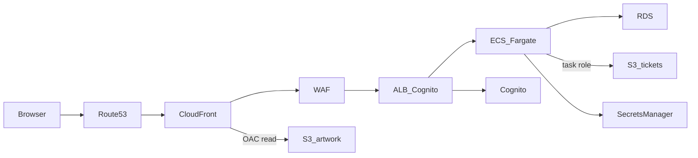

# Scratch card on AWS

Run the game on your machine first. AWS comes after the rules behave the way you expect.

```bash
npm install
npm run dev
```

Open http://localhost:3000. Sign-in is skipped because `npm run dev` sets `NODE_ENV=development`. The player id is `local-player` unless you set `DEV_AUTH_SUB`. Game state is stored by PGlite in `.data/`, so the two daily plays survive a restart. Set `DATABASE_URL` only when you want the same SQL to run against PostgreSQL. Docker is not part of this check. The Dockerfile exists so the same app can be built for ECS later.

`npm run check` repeats the credit, replay, reset, and jackpot rules against a throwaway database in `.data-check/`.

What to confirm before you open the AWS console:

- Two plays succeed, and the third is rejected.
- Sending the same play token again is rejected.
- The prize on the card is the prize in the response from `POST /api/play`. The page does not roll a number.

The demonstration section is the security review. The numbered stages under it are the settings that matter when you build the same design. They are not a click-path. Play, screenshot, and sign-in sequences are in [diagrams.md](diagrams.md).

Region for the account resources is `eu-west-2`, across two Availability Zones. Two certificates and the WAF are the exception: CloudFront and a WAF attached to CloudFront live in `us-east-1`. Substitute your domain wherever this guide says `scratch.example.com`.

```text
Browser
  -> Route 53
  -> CloudFront (certificate in us-east-1)
  -> WAF (also us-east-1)
  -> ALB with Cognito (certificate in eu-west-2)
  -> ECS Fargate, private subnets
  -> RDS PostgreSQL, private subnets

CloudFront also reads the card artwork from a private S3 bucket through Origin Access Control.
```

## Demonstration

Walk the review in this order. Each part below is something you can point at in this repository, in the GitHub repo, or in the role that already assumed successfully.

### Architecture

`eu-west-2` holds the app and the database. CloudFront, its certificate, and the WAF are in `us-east-1`.



Public subnets hold the load balancer and one NAT gateway. Tasks and RDS have no public address. The artwork bucket is readable only by this CloudFront distribution. The ticket bucket is readable only by the task.

| Choice | Why it is there |
| --- | --- |
| Fargate in private subnets | The task has no SSH and no public address. Replacing the image is the patch. |
| Cognito on the load balancer | The password and the app-client secret stay on the listener. The task receives a signed JWT. |
| The app checks that JWT | The page cannot choose its own user id. `DEV_AUTH_SUB` works only when `NODE_ENV=development`. |
| PostgreSQL | The daily credit is one conditional `UPDATE`. The jackpot is one locked row. |
| CloudFront in front of the load balancer | TLS, WAF, and a public name that is not the origin. |
| Two certificates | CloudFront can use only a `us-east-1` certificate. The load balancer certificate is in `eu-west-2` and matches `scratch.example.com`, because the viewer `Host` is forwarded. |
| Two private buckets | Artwork is a CloudFront read through Origin Access Control. A ticket is drawn by the task from the `plays` row and stored for that player. |
| Separate task and execution roles | The running game can read one secret and one bucket. Pulling the image and writing logs cannot. |
| GitHub OIDC | A deploy is a short-lived role session. The repo stores the role ARN, which is a name, and no access key. |
| SSE-S3 | Both buckets encrypt objects with AES-256. A key you rotate yourself is called out under residual risk. |

### Threat modelling

Assets worth naming:

- The prize decision and the single £1,000,000 jackpot row.
- The `plays` table, which is the record of who played and what they were paid.
- The player identity (`sub` from Cognito).
- Ticket images, because a picture of a win is something a player will treat as proof.
- The database password, the Cognito client secret, and the deploy role.
- `src/play.js` and `prize_tiers`, because that is where the odds and the credit spend live.

Trust boundaries:

1. Browser to CloudFront. The client is untrusted. TLS ends at CloudFront.
2. CloudFront to the load balancer. Only the CloudFront origin prefix list can open 443, and CloudFront adds an origin header the listener requires.
3. Anonymous browser to signed-in browser. Cognito runs on the listener before the request is forwarded.
4. Load balancer to the task. The app accepts `x-amzn-oidc-data` only after the ELB signature, expiry, and `ALB_ARN` signer check.
5. Task to RDS and the ticket bucket. The database allows 5432 from the task security group. The ticket bucket allows the task role.
6. CloudFront to the artwork bucket. Origin Access Control, restricted with `AWS:SourceArn`.
7. GitHub Actions to the AWS account. The role trusts one repository id and the `production` environment.
8. A developer to `main`. A change arrives as a pull request with a review and the pipeline checks.

The threats that matter, and the control for each:

| Threat | How it is handled |
| --- | --- |
| The page invents a win | `POST /api/play` draws with `crypto.randomInt`. The screenshot PNG is drawn on the server from that `plays` row. |
| The same play is sent twice, or two requests race the last credit | The token is consumed in the same transaction as the conditional credit `UPDATE`. A second use updates zero rows and the transaction rolls back. |
| Two players both take the jackpot | The transaction locks the row with `SELECT ... FOR UPDATE` and claims it only while the status is `available`. The next claim is stored as a loss. |
| A player opens someone else's ticket | The object key is `tickets/{user}/{play}.png`. The play must belong to the authenticated `sub`, or the response is 404. |
| Someone calls the load balancer and skips WAF | The security group allows 443 only from `com.amazonaws.global.cloudfront.origin-facing`. The listener also requires the origin header CloudFront sets, so a viewer-supplied copy of that header is overwritten. |
| A stolen access key deploys to the account | Deploy uses OIDC. The trust policy allows `sts.amazonaws.com` and one subject: `repo:gindriliunas@213284389/lotto@1423209416:environment:production`. |
| A pull request makes a bucket public | Trivy fails the pull request on the S3 public-access rules. Account-level Block Public Access still blocks a bucket created in the console. |
| The database is reached from the internet | No public address. Port 5432 accepts the task security group only. The connection uses TLS and the RDS CA bundle in `certs/global-bundle.pem`. |
| Odds change with no one watching | Odds live in `prize_tiers`. A change to `src/play.js` needs a second approver as well as the production environment review. |

### GitHub security

The repository, the people, and the code are three different controls.

The lab repo is public: https://github.com/gindriliunas/lotto. For a real prize pool, make it private. A public repo lets anyone read the draw. Secret scanning, push protection, and Dependabot alerts are already on, so a committed key or a database URL is rejected before it lands.

A ruleset targets the default branch, `main`. The bypass list is empty, so a direct push is refused for the owner as well. A change arrives as a pull request. After `.github/workflows/security.yml` has run once on GitHub, require these checks: **SAST**, **SCA**, **Reject a bucket that is not private**, **Container**, **Secret**, and **DAST**. Give `src/play.js` a second approver, because that file spends credits and draws the prize. The GitHub user that can approve should have MFA.

The production environment already has a required reviewer. The Deploy job declares `environment: production`, so GitHub holds the job, and the OIDC token, until that review is approved. In this lab the reviewer is the same user who starts the run. That gap is listed under residual risk.

Developers do not put AWS keys in GitHub secrets. `AWS_ROLE_ARN` is the role name `arn:aws:iam::631026310596:role/gindriliunas`. The workflow may hardcode that same ARN. Neither value is a credential. Which browser account is signed in does not choose the AWS identity. The token subject is the repository id and the environment.

`.env` stays out of git. The RDS CA file in `certs/` is Amazon's public bundle, so it is safe to commit.

### CI/CD security

GitHub Actions deploys by assuming a role, then doing only the API calls that role allows.

The account has an IAM OIDC provider for `https://token.actions.githubusercontent.com`, audience `sts.amazonaws.com`. The role is `gindriliunas`. Its trust policy allows `sts:AssumeRoleWithWebIdentity` when both of these match:

- `token.actions.githubusercontent.com:aud` is `sts.amazonaws.com`
- `token.actions.githubusercontent.com:sub` is `repo:gindriliunas@213284389/lotto@1423209416:environment:production`

The numbers are the GitHub user id and the repository id. Repositories created after 15 July 2026 send that form. A policy that still says `repo:gindriliunas/lotto:environment:production`, or the wizard's `ref:refs/heads/main`, is denied. The denial looks like `Not authorized to perform sts:AssumeRoleWithWebIdentity`. The working run printed `arn:aws:sts::631026310596:assumed-role/gindriliunas/GitHubActions`.

The job asks for `id-token: write` and `contents: read`. It does not ask for permission to change the repository. `aws-actions/configure-aws-credentials@v4` exchanges the token. The session lasts for the job.

The assume-role test is done. The permission policy is the next tightening, added when the repository and the service exist, and limited to:

- `ecr:GetAuthorizationToken` on `*`
- push to `arn:aws:ecr:eu-west-2:631026310596:repository/scratch-card`
- `ecs:DescribeServices` and `ecs:UpdateService` on `arn:aws:ecs:eu-west-2:631026310596:service/scratch-card/scratch-card`

Checks on the way to that deploy. `.github/workflows/security.yml` runs all six on a pull request and again on a push to `main`. A high or critical finding fails the check. None of them deploy anything.

- **SAST.** Semgrep 1.181.0 scans the JavaScript with the `javascript` and `nodejs` rules. An error-level finding fails the job.
- **SCA.** Trivy 0.76 reads `package-lock.json` and fails on a high or critical dependency vulnerability that has a fix.
- **Terraform.** Trivy config-scans `infra/` and fails on a high or critical misconfiguration. It does not run `terraform apply`. The S3 findings that fail a public bucket are `AWS-0086`, `AWS-0087`, `AWS-0088`, `AWS-0091`, `AWS-0093`, and `AWS-0094`. The check name is **Reject a bucket that is not private**.
- **Container.** The workflow builds the Dockerfile and Trivy scans that image. ECR scan-on-push repeats the scan in the account. A critical finding stops the rollout.
- **Secret.** Gitleaks 8.30.1 scans the checkout and its git history. `.gitleaks.toml` ignores only `certs/global-bundle.pem`, which is Amazon's public CA bundle. GitHub push protection is the earlier block, at the moment of the push.
- **DAST.** The job starts the app with `NODE_ENV=development` and runs the OWASP ZAP 2.17.0 baseline against `http://127.0.0.1:3000`. A warning does not fail the job. A ZAP failure does.
- `npm run check` repeats the credit, replay, reset, and jackpot rules. It is not in this workflow yet.
- The ECS deployment circuit breaker rolls back a task that fails `GET /health`.

### AWS security

Network. Two public subnets hold the load balancer and one NAT gateway. Two private subnets hold the tasks and RDS, with no public addresses. Security groups refer to each other: tasks accept 3000 from the load balancer group, and RDS accepts 5432 from the task group. Private route tables send `0.0.0.0/0` to the NAT gateway so the tasks can reach ECR, Secrets Manager, and CloudWatch.

Edge. Route 53 aliases the public name to CloudFront. WAF, in `us-east-1`, adds the AWS managed common rule group, Bot Control on the play path, and a rate-based rule for `/api/play` and `/api/play-token`. That rate is per address. The two-plays-a-day rule is the database update, because WAF runs before Cognito and never sees `sub`. Caching is disabled, and the origin request policy is `AllViewer`, so the Cognito callback stays on `scratch.example.com`.

Compute. Fargate, public IP off, logs to CloudWatch. `/health` does not touch the database and does not require a session, because the load balancer health check cannot log in. Every other path requires the Cognito action on the listener.

Data. RDS is Multi-AZ, encrypted, and not publicly accessible. Both buckets block all four public-access settings, version objects, encrypt with SSE-S3, and deny `aws:SecureTransport=false`. The artwork policy allows `s3:GetObject` only for this distribution. The ticket policy has no allow for CloudFront. Account-level S3 Block Public Access covers buckets the pipeline cannot see.

### Secrets and identity

| Who | What they prove | Where the secret is |
| --- | --- | --- |
| Player | Cognito hosted UI, then the ALB session cookie. The app verifies `x-amzn-oidc-data` with the region's ELB public key, requires `exp`, and matches `signer` to `ALB_ARN`. | The Cognito client secret stays on the listener. |
| Task | The task role. | The RDS password is in Secrets Manager and rotates with the RDS rotation Lambda. The app reads it at startup and reads it again if PostgreSQL returns `28P01`. |
| Image pull and logs | The execution role. | That role cannot read the database secret. |
| GitHub Actions | The OIDC subject above. | The credentials exist for the job, then disappear. |
| TLS | ACM serves the certificates. | One in `us-east-1` for CloudFront, one in `eu-west-2` for the load balancer. ACM renews them. |
| Local play | `DEV_AUTH_SUB` while `NODE_ENV=development`. | Production refuses to start without `DB_SECRET_ARN` or `DATABASE_URL`, and ignores the dev user. |

The task role's S3 actions are `PutObject` and `GetObject` on the ticket bucket. It cannot write the artwork bucket.

### Monitoring and operations

Detection starts from the logs the app already writes. A play line is JSON with `event`, `userId`, `playId`, `outcome`, and `prizePence`. It leaves out the play token. A screenshot line has the user and the play id. Unexpected failures log `event: error`.

Alarms to put on those logs and on the edge:

- More than two accepted plays for one `userId` on one London day. The conditional update should have made that impossible, so the alarm means a bug or a bypass.
- A play whose `prizePence` is `100000000`. That is the jackpot. A person should see it, not only a dashboard.
- A rise in HTTP 409 (`no_credits`, `token_rejected`) or 404 on screenshot reads.
- WAF blocked counts on the play paths, and ALB 5xx or unhealthy targets.
- An ECS deployment rollback from the circuit breaker.

CloudTrail in `eu-west-2` is the record of the control plane. Alarm on `AssumeRoleWithWebIdentity` that is denied, on `UpdateService`, on `GetSecretValue` outside the task, and on bucket-policy or CloudTrail changes. GuardDuty covers the account for credentials used from an unexpected place. The failed assume-role attempts in this lab are the example: the error text in GitHub was generic, and the trust mismatch was the cause.

### Residual risk

These stay true after the controls above.

- The GitHub repo is public, so the draw can be read. A real prize pool uses a private repo.
- The user who starts Deploy is also the production reviewer, so the review is not a second person yet.
- The deploy role has been proven for identity only. Until its permission policy is limited to the ECR repository and the one ECS service, do not treat it as a deploy role.
- GitHub Actions are pinned to `@v4`, which moves. Pin `aws-actions/configure-aws-credentials` to a commit SHA.
- One NAT gateway. A zone failure, or a failure of that NAT, stops the tasks reaching ECR, Secrets Manager, and CloudWatch. Production has a NAT in each zone.
- Buckets use SSE-S3. `.trivyignore` exempts `AWS-0132` because that check wants a customer-managed key. Say the difference: the pipeline fails a public bucket, and it does not claim SSE-S3 is a key you rotate.
- `crypto.randomInt` is fit for this lab. A real stake needs an independently tested generator and the audit trail the UK Gambling Commission expects. The `plays` table is the trail. The generator is not certified.
- Cognito email is not identity enough to pay £1,000,000. Paying a prize needs a separate checked identity. This design stops a forged win. It does not perform that check.
- The WAF limit is per IP and runs before sign-in. Addresses behind one NAT share it, and a careful caller under the limit still reaches the two-play rule.
- Schema changes run when the process starts. A bad migration would start on every new task. Production runs migrations as a separate one-off task.
- This is one AWS account with no service-control policy around it. Account-level Block Public Access is a console setting the pull request cannot see.
- A bug in the credit transaction is still the way to get a third play. The review on `src/play.js` and `npm run check` are the controls, and they are people and tests, not a second enforcement point in the database.

## Build order

Build in this order. Later stages need names and security groups from earlier ones.

## 1. VPC

One VPC. Two public subnets and two private subnets, one of each per Availability Zone.

The public subnets hold the load balancer and a single NAT gateway. The tasks and the database go in the private subnets and do not get public addresses. One NAT is a cost compromise for the lab (about £30 a month before data charges). In a design review, say that production uses a NAT gateway in each Availability Zone so one zone cannot cut the tasks off from Amazon ECR, Secrets Manager, and CloudWatch.

Correct when a route table on the public subnets sends `0.0.0.0/0` to the internet gateway, and a route table on the private subnets sends `0.0.0.0/0` to the NAT gateway. The private route table must not point at the internet gateway.

## 2. Security groups

Three groups, and each rule names another group rather than a wide CIDR.

| Group | Inbound |
| --- | --- |
| Load balancer | TCP 443 from the CloudFront origin-facing managed prefix list `com.amazonaws.global.cloudfront.origin-facing` |
| Tasks | TCP 3000 from the load balancer security group only |
| Database | TCP 5432 from the task security group only |

The load balancer group is not open to `0.0.0.0/0`. WAF does not have a security group you can reference. The prefix list is what stops someone from calling the load balancer directly and skipping CloudFront. A second check is in stage 6: the listener requires a custom header that only CloudFront adds.

Correct when the database has no route from the internet, and the task group does not allow your home IP.

## 3. RDS

PostgreSQL, Multi-AZ, storage encrypted, not publicly accessible, in the private subnets. Put the master password in Secrets Manager and turn on the native RDS rotation. That rotation is a Lambda AWS already provides for RDS secrets. It is not a reminder to rotate by hand.

The ECS task role and the task execution role stay separate.

- The execution role pulls the image from ECR and writes logs. It does not read the database secret.
- The task role can call `secretsmanager:GetSecretValue` on that one secret, plus `s3:PutObject` and `s3:GetObject` on the ticket-screenshot bucket only. It cannot read or write the artwork bucket. The app reads the database secret at startup. If a connection fails with an authentication error, it reads the secret again and reconnects. A rotated password does not need a new deploy.

Set `DB_SECRET_ARN` and `TICKET_BUCKET` on the task. Leave `DATABASE_URL` unset in AWS. The RDS connection uses TLS and the Amazon RDS CA bundle in `certs/global-bundle.pem`.

Schema changes run when the process starts. That is acceptable for this lab. In production, run migrations as a separate one-off task. A bad migration should not start on every replica.

Correct when the instance endpoint is a private address, the secret rotates on a schedule, and a laptop cannot open port 5432.

## 4. Image and ECS

Create an ECR repository with scan on push. Build locally, scan with Trivy, then push:

```bash
docker build -t scratch-card .
trivy image scratch-card
```

The ECS service runs Fargate in the private subnets with a public IP disabled. The container listens on port 3000. The target group health check is `GET /health`. That path does not touch the database and does not require a Cognito session, because the load balancer health checker cannot log in.

Start with one task. Raise the desired count to two when you want a task in each zone. Turn on the deployment circuit breaker with rollback, so a task that fails its health check rolls the service back instead of staying broken.

Logs go to CloudWatch from the process stdout. A play log line has the user id, play id, outcome, and prize. It does not include the play token.

Correct when a new task becomes healthy without a public address, and a deliberately bad image rolls back.

## 5. Cognito

Create a user pool with email sign-in, a hosted UI domain, and an app client that has a client secret. The load balancer's built-in Cognito action only works with a confidential client.

Callback URL: `https://scratch.example.com/oauth2/idpresponse`

Sign-out URL: `https://scratch.example.com/`

Keep a copy of the client secret in Secrets Manager. The listener also stores the secret it uses for the code exchange. The app never sees that secret. After the load balancer authenticates the browser, it sends the task a signed JWT in `x-amzn-oidc-data`. The app verifies that JWT with the region's ELB public key and reads `sub` from the verified payload. It does not trust `x-amzn-oidc-identity` on its own, and it does not accept a user id from the page.

Set `ALB_ARN` on the task to the load balancer ARN. The JWT `signer` claim has to match it, so a token minted for a different load balancer is rejected. `DEV_AUTH_SUB` is ignored unless `NODE_ENV=development`, and the container runs with `NODE_ENV=production`.

Correct when a user who is not signed in is redirected to the hosted UI, and a signed-in request reaches the task with a JWT the app accepts.

## 6. Load balancer

Put the load balancer in the public subnets. The listener is HTTPS and uses the `eu-west-2` certificate for `scratch.example.com`.

Default action: authenticate with Cognito, then forward to the target group. Add a higher-priority rule for `/health` that forwards with no authentication.

Add one more rule condition on the authenticated path: a custom header, for example `X-Origin-Verify`, must match a long random value. Configure CloudFront to send that header to the origin. A request that reaches the load balancer without it gets a fixed 403 response. Together with the prefix list in stage 2, traffic has to pass CloudFront and WAF first.

Correct when `/health` returns 200 from inside the VPC path, the site redirects anonymous users to Cognito, and a direct request that omits the header is rejected.

## 7. CloudFront and certificates

Request two public certificates for the same name.

- The CloudFront certificate is in `us-east-1`. CloudFront will not see a certificate created in London.
- The load balancer certificate is in `eu-west-2`.

Use the CloudFront default cache policy that disables caching, and the `AllViewer` origin request policy. `AllViewer` forwards the viewer's `Host` header, cookies, and query string. Cognito's redirect URI is `https://scratch.example.com/oauth2/idpresponse`. If CloudFront replaces `Host` with the load balancer's DNS name, the hosted UI redirects to the wrong place and the callback fails. The load balancer certificate has to match that same host, which is why the London certificate exists.

Do not use the managed origin request policy that strips the host header. That policy is the usual choice for a plain load balancer origin, and it breaks this login.

Correct when the browser stays on `scratch.example.com` from the first request through the Cognito redirect and back, and the session cookie is presented on the next play.

## 8. WAF

Create the web ACL in `us-east-1` and attach it to the CloudFront distribution. An ACL created in `eu-west-2` cannot be attached to CloudFront.

Add the AWS managed common rule group, the Bot Control rule group, and a rate-based rule whose scope-down statement matches the play path (`/api/play` and `/api/play-token`). The rate key is the source IP.

That limit is per address. It is not the two-plays-a-day rule. WAF runs before Cognito, so it never sees the user's `sub`. The per-user limit is the conditional credit update in PostgreSQL. A user far above two plays in a London day is the CloudWatch signal for a bug or an attempt to get around the credit check.

Bot Control is a paid managed rule. Leave it off if you only need to see the rate-based rule work, and say in a review that you would turn it on for the play path.

Correct when a burst of play requests from one address is blocked at the edge, and a normal signed-in play still reaches the task.

## 9. Route 53

Alias `scratch.example.com` to the CloudFront distribution. Do not point the name at the load balancer. The name the user types has to be the name on the CloudFront certificate and the Cognito callback.

Correct when the public name resolves to CloudFront, and the load balancer DNS name is not the name users are given.

## 10. Private S3 buckets

Two buckets, both defined in Terraform in `infra/s3`. The scan in the next section can only see resources that are in the repository, so neither bucket is created in the console.

The artwork bucket holds the scratch card face. The browser and the task never receive S3 credentials for it. CloudFront reads the object with Origin Access Control, and the bucket policy allows `s3:GetObject` only for that distribution's source ARN.

The ticket bucket holds a screenshot of a play. It is private in a stricter sense: CloudFront is not allowed to read it. When a signed-in player clicks Save screenshot, the task draws a PNG from that player's row in `plays` and uploads it with SSE-S3. The page never sends the pixels. A screenshot of someone else's play is rejected, because the object key is built from the authenticated user and the play must belong to them. Set `TICKET_BUCKET` to this bucket's name. Locally, with that variable unset, the same PNG is written under `.data/tickets/` so you can try the button before AWS.

The preset on both buckets:

- All four Block Public Access flags: block public ACLs, block public policy, ignore public ACLs, restrict public buckets.
- Default encryption with SSE-S3 (AES256).
- Versioning.
- A bucket policy that denies any request where `aws:SecureTransport` is false.
- On the artwork bucket only, one allow for `cloudfront.amazonaws.com`, restricted with `AWS:SourceArn`. The ticket bucket has no allow. There is no `Principal: "*"` on an allow, and there is no public ACL.

Apply them yourself when the distribution exists:

```bash
terraform -chdir=infra/s3 init
terraform -chdir=infra/s3 apply \
  -var="bucket_name=YOUR-UNIQUE-ARTWORK-NAME" \
  -var="ticket_bucket_name=YOUR-UNIQUE-TICKET-NAME" \
  -var="cloudfront_distribution_arn=arn:aws:cloudfront::ACCOUNT:distribution/ID"
```

Correct when both block-public-access panels show all four blocks on, a direct public object URL returns Access Denied, the card face still loads on `scratch.example.com` through CloudFront, and a saved screenshot is visible only after sign-in.

### Why GitHub can refuse a public bucket

`.github/workflows/security.yml` scans `infra/` with Trivy 0.76 on a pull request and on `main`. It fails on any high or critical misconfiguration. Trivy is the maintained successor of tfsec. The S3 rules that keep this bucket private are:

- `aws-s3-block-public-acls` (Trivy report `AWS-0086`) rejects a bucket that does not block public ACLs.
- `aws-s3-block-public-policy` (`AWS-0087`) rejects a bucket that does not block public policies.
- `aws-s3-enable-bucket-encryption` (`AWS-0088`) rejects a bucket with no default encryption.
- `aws-s3-ignore-public-acls` (`AWS-0091`) rejects a bucket that does not ignore public ACLs.
- `aws-s3-no-public-buckets` (`AWS-0093`) rejects a bucket that does not restrict public policies.
- `aws-s3-specify-public-access-block` (`AWS-0094`) rejects a bucket with no public access block at all.

A diff that removes the public access block or turns a flag off fails the check. The workflow does not run `terraform apply`.

`.trivyignore` exempts `AWS-0132` only. That check demands a customer-managed KMS key. The preset is SSE-S3, which already satisfies the encryption rule above. Say that distinction if you are asked: the pipeline fails a public bucket, and it does not pretend SSE-S3 is the same requirement as a key you rotate yourself.

The check has a limit you should say out loud: GitHub never sees a bucket created in the console. Turn on S3 Block Public Access at the account level once. New buckets in git are rejected unless they match the preset, and a bucket created by hand still cannot be made public.

## 11. Deploy, and what to delete

Lab deploy of the app, after the image scan:

```bash
docker build -t ACCOUNT.dkr.ecr.eu-west-2.amazonaws.com/scratch-card:latest .
docker push ACCOUNT.dkr.ecr.eu-west-2.amazonaws.com/scratch-card:latest
```

Force a new ECS deployment. The circuit breaker watches the health check.

The identity provider and the role `gindriliunas` already exist. What the role is allowed to do, and the checks that run before a deploy, are in the CI/CD section above. A change under `src/play.js` (the odds read, the draw, or the credit update) needs a second approver as well as the production environment review. CloudTrail is the record of who changed the service and who changed the secret.

Turn the stack off when you are finished. The expensive pieces are the NAT gateway, the load balancer, Multi-AZ RDS, Fargate, and the WAF (the web ACL and Bot Control). Delete the ECS service first, then the load balancer, the RDS instance, and the NAT gateway. Release the Elastic IP attached to the NAT gateway. Empty the ECR repository and both S3 buckets before you delete them. Left running, the full path is on the order of £80–150 a month. The buckets by themselves are cheap.

## Game rules the server enforces

These are the rules worth defending in a review. The page is only the scratch foil.

- A saved screenshot is drawn on the server from the `plays` row. The browser cannot upload its own image of a win.
- The client never decides a win. `POST /api/play` draws from the `prize_tiers` table with `crypto.randomInt`. Practice odds are 70% no win, 25% £2, and 5% a jackpot attempt, so a win shows up in the lab. A real game would use an independently tested generator. The UK Gambling Commission Remote Gambling and Software Technical Standards require that testing, and an audit trail of the outcome. The `plays` table is that trail: who played, which token, what the outcome was, and the prize in pence.
- There is one £1,000,000 jackpot row. The transaction locks it with `SELECT ... FOR UPDATE` and claims it only if the status is still `available`. A second jackpot roll is stored as a loss.
- Each play needs a server-issued token. The token is consumed in the same transaction as the credit update. Using it twice matches zero rows and the transaction rolls back.
- Each user has two plays per London calendar day. The reset is lazy. There is no midnight job. This is the statement that spends the credit:

```sql
UPDATE user_credits
SET credits_remaining = CASE
      WHEN last_reset_date < $2::date THEN 2
      ELSE credits_remaining
    END - 1,
    last_reset_date = CASE
      WHEN last_reset_date < $2::date THEN $2::date
      ELSE last_reset_date
    END
WHERE user_id = $1
  AND (last_reset_date < $2::date OR credits_remaining > 0)
RETURNING credits_remaining;
```

If it returns no row, the play is rejected. A read of the balance followed by a later write would let two requests both pass.

Odds live in `prize_tiers`, not in an environment variable and not in the browser. Changing them is a data change with a review, which is the same reason `src/play.js` has a second approver.
