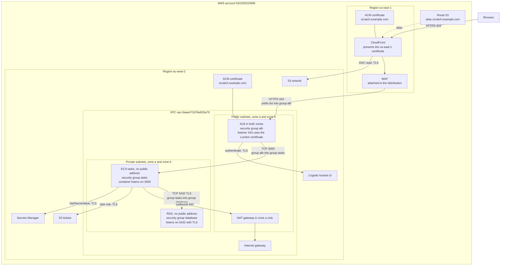
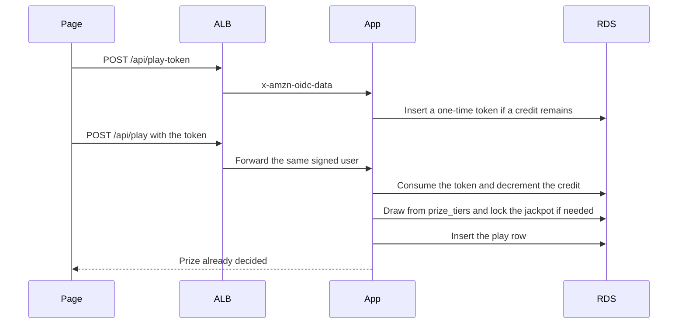
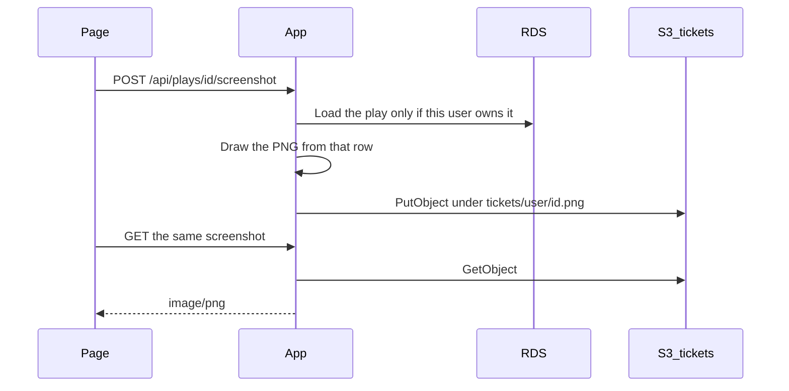
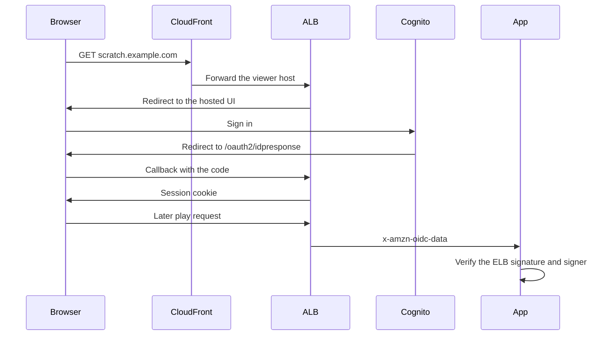

# Scratch card diagrams

The same pictures are in the design canvas. These copies stay in the repo.

## High-level design

The order is **account → region → VPC → availability zone → subnet**. A VPC lives in one region. A subnet lives in one availability zone.

| Level | This lab |
| --- | --- |
| Account | `631026310596`. The bill and the IAM role `gindriliunas`. |
| Region | `eu-west-2` (London) for the app, the database, and the load balancer. |
| VPC | `vpc-0eae471976e833a79`. Address ranges `172.51.0.0/16` and `172.31.0.0/16`. The second range is unused. |
| Availability zone | `eu-west-2a` and `eu-west-2b`. |
| Subnet | `public-a` and `private-a` in zone a. `public-b` and `private-b` in zone b. |

CloudFront, its certificate, and the WAF are the parts that sit in `us-east-1` instead. One NAT gateway sits in one public subnet. A production design would put a NAT gateway in each zone.

The browser stays outside the account. Route 53 is inside the account and is not tied to one region. Each region is a box inside the account, and the London box holds the VPC. The same name, `scratch.example.com`, has a certificate in each region. The three security groups are on the load balancer, the tasks, and the database.

| Certificate | Region | Presented by |
| --- | --- | --- |
| `scratch.example.com` | `us-east-1` | CloudFront, to the browser. CloudFront cannot use the London certificate. |
| `scratch.example.com` | `eu-west-2` | The load balancer listener on 443. It must match the `Host` that `AllViewer` forwards, or the Cognito callback fails. |

| Security group | Attached to | Inbound |
| --- | --- | --- |
| Load balancer | The load balancer in both public subnets | TCP 443 from the CloudFront origin-facing prefix list `com.amazonaws.global.cloudfront.origin-facing`. Not from `0.0.0.0/0`. |
| Tasks | The ECS tasks in the private subnets | TCP 3000 from the load balancer group only. The health check `GET /health` uses this same port and does not log in. |
| Database | RDS in the private subnets | TCP 5432 from the task group only. |

Outbound on these groups stays open. The inbound rules are the fence. Tasks reach ECR, Secrets Manager, CloudWatch, and S3 through the NAT gateway on 443. The database group never needs a path from the internet. WAF has no security group; it is attached to the distribution in `us-east-1`.

| Part | Restriction |
| --- | --- |
| Browser | Untrusted. It cannot choose the prize, the user id, or the ticket picture. |
| Route 53 | The public name aliases to CloudFront. It does not alias to the load balancer. |
| CloudFront | Certificate in `us-east-1` only. Caching is disabled. `AllViewer` forwards the viewer `Host`, or the Cognito callback breaks. The origin header is set by CloudFront and overwrites a copy sent by the browser. |
| WAF | Created in `us-east-1` and attached to CloudFront. Rate limit is per IP on the play paths. It runs before sign-in, so it cannot enforce two plays per user. |
| Load balancer | Subnets in two zones. AWS rejects a load balancer in one zone. Port 443 accepts the CloudFront origin prefix list only. The listener requires the origin header, then Cognito. `/health` skips Cognito and does not touch the database. Certificate in `eu-west-2`. |
| NAT gateway | One, in one public subnet. Private subnets send `0.0.0.0/0` here. It translates the task's private address for outbound calls and does not accept a connection that starts on the internet. If zone a fails, tasks in zone b lose ECR, Secrets Manager, and CloudWatch. |
| Internet gateway | Only the public route tables point at it. The private route tables must not. |
| ECS | Private subnets, public IP off. Port 3000 accepts the load balancer security group only. The task role may read one database secret and the ticket bucket. The execution role may pull the image and write logs, and may not read that secret. |
| RDS | Private subnets in both zones, even for a single-AZ instance, because a subnet group needs two zones. No public address. Port 5432 accepts the task security group only. Storage encrypted. Clients use TLS. The password is in Secrets Manager and rotates. |
| S3 artwork | All four Block Public Access flags, versioning, SSE-S3, and a deny when transport is not TLS. `GetObject` is allowed only for this CloudFront distribution. The task role cannot read it. |
| S3 tickets | Same bucket preset, and no allow for CloudFront. The task role may `PutObject` and `GetObject` only. The key is `tickets/{user}/{play}.png`, and the play must belong to that user. |
| Cognito | The client secret stays on the listener. The app sees only the signed `x-amzn-oidc-data` JWT, checks expiry, and matches `signer` to the load balancer. |
| Secrets Manager | The task role can read the one RDS secret. A password error makes the app read it again. |

## Data flow: one play

A third play the same London day updates no credit row. Sending the same token again rolls the transaction back.

## Data flow: save screenshot

The browser never uploads the picture. Locally, with `TICKET_BUCKET` unset, the file is written under `.data/tickets/` instead of S3.

## Data flow: sign-in

`/health` is the only path that skips Cognito, because the load balancer health check cannot log in.
