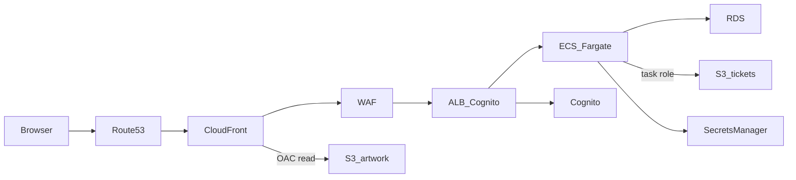
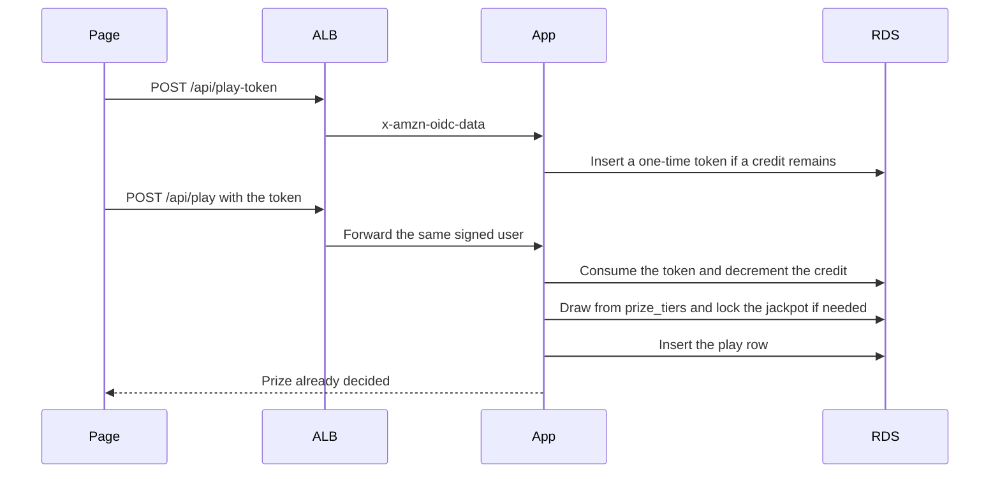
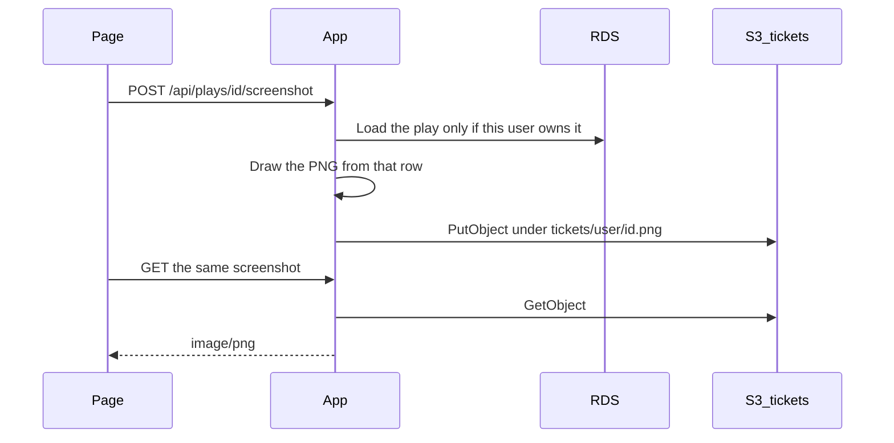
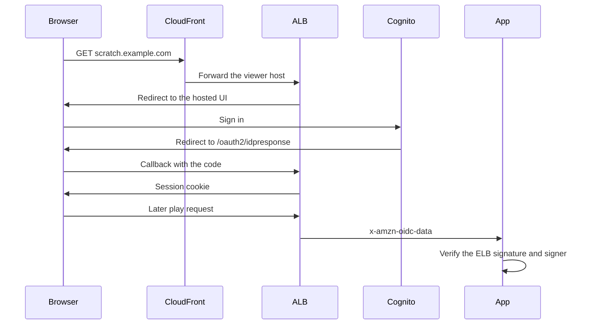

# Scratch card diagrams

The same pictures are in the design canvas. These copies stay in the repo.

## High-level design

`eu-west-2` holds the app and the database. CloudFront, its certificate, and the WAF are in `us-east-1`.

Public subnets hold the load balancer and one NAT gateway. Tasks and RDS have no public address. The artwork bucket is readable only by this CloudFront distribution. The ticket bucket is not.

## Data flow: one play

A third play the same London day updates no credit row. Sending the same token again rolls the transaction back.

## Data flow: save screenshot

The browser never uploads the picture. Locally, with `TICKET_BUCKET` unset, the file is written under `.data/tickets/` instead of S3.

## Data flow: sign-in

`/health` is the only path that skips Cognito, because the load balancer health check cannot log in.
